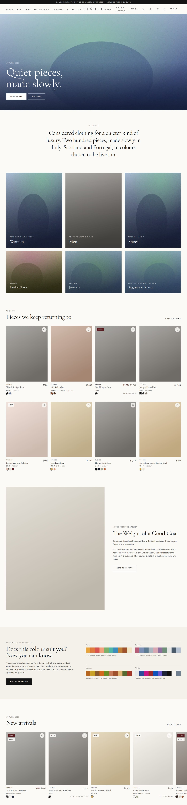
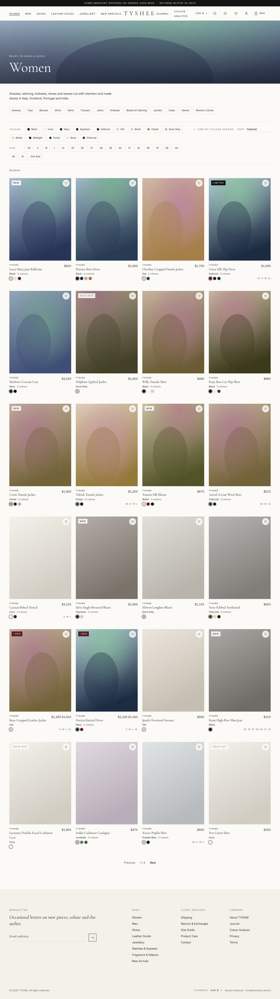
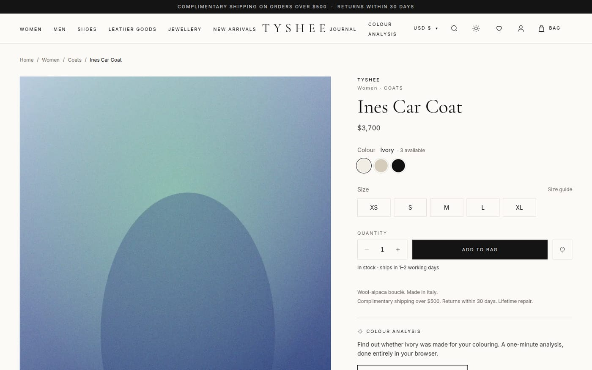
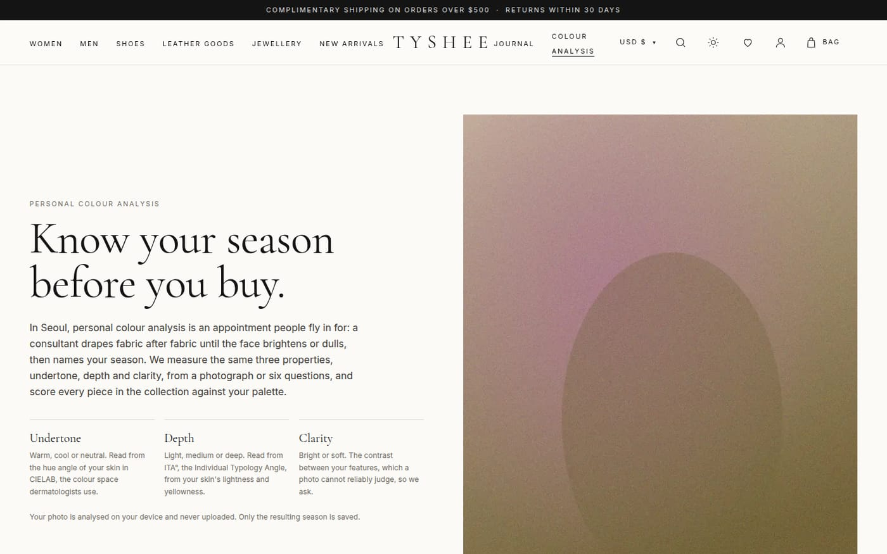

# TYSHEE — a luxury storefront built for image performance

> Considered pieces, made slowly. A complete luxury fashion storefront: a 200-product catalogue with real colour variants and stock, editorial photography, wishlist, cart, checkout, accounts, three appearance modes and an in-browser personal colour analysis. Built on Next.js 16 / React 19 with an obsessive focus on how images are requested, sized, prioritised and cached.

<!-- SCREENSHOTS -->
<table><tr><td width="50%"><br/><sub>Home</sub></td><td width="50%"><br/><sub>Collection with filters</sub></td></tr><tr><td width="50%"><br/><sub>Product page with colour analysis</sub></td><td width="50%"><br/><sub>Personal colour analysis</sub></td></tr></table>

<sub>Screenshots captured against the local imgix-compatible mock origin (synthetic photographs). On a normal network the same slots show Unsplash editorial photography.</sub>
<!-- /SCREENSHOTS -->

## Lighthouse

<!-- LIGHTHOUSE -->
Lighthouse 13, mobile = simulated Moto G Power on slow 4G, desktop = standard preset. Reports in [`lighthouse/`](lighthouse/).

| Page | Device | Performance | Accessibility | Best Practices | SEO | LCP | TBT | CLS | Page weight |
|---|---|---:|---:|---:|---:|---:|---:|---:|---:|
| home `/` | mobile | **92** | 100 | 100 | 100 | 3.35s | 39ms | 0.000 | 495 KB |
| collection `/collections/women` | mobile | **96** | 100 | 100 | 100 | 2.74s | 40ms | 0.000 | 620 KB |
| product `/products/ines-car-coat` | mobile | **92** | 100 | 100 | 100 | 3.29s | 38ms | 0.000 | 474 KB |
| journal `/journal/the-weight-of-a-good-coat` | mobile | **93** | 100 | 100 | 100 | 3.25s | 34ms | 0.000 | 524 KB |
| home `/` | desktop | **100** | 100 | 100 | 100 | 0.74s | 0ms | 0.000 | 633 KB |
| collection `/collections/women` | desktop | **99** | 100 | 100 | 100 | 0.85s | 0ms | 0.012 | 829 KB |
| product `/products/ines-car-coat` | desktop | **98** | 100 | 100 | 100 | 1.16s | 0ms | 0.000 | 742 KB |
| journal `/journal/the-weight-of-a-good-coat` | desktop | **100** | 100 | 100 | 100 | 0.73s | 0ms | 0.000 | 724 KB |


<!-- /LIGHTHOUSE -->

Run it yourself with `npm run lighthouse` (details in [docs/PERFORMANCE.md](docs/PERFORMANCE.md)). CI fails if any audited page scores under 90 for performance.

## What is in the box

| Area | Implementation |
|---|---|
| Framework | Next.js 16 (App Router, React Server Components, Turbopack), React 19, TypeScript, Tailwind CSS 4 |
| Catalogue | 200 products across 36 categories in a taxonomy (`src/data/taxonomy.ts`): women's and men's ready-to-wear (dresses, tops, blouses, shirts, skirts, trousers, jeans, knitwear, tailoring, jackets, coats, sarees), shoes (heels, flats, ballerinas, sandals, boots, boat shoes), leather goods, ten jewellery subcategories, watches, eyewear, fragrance and objects. Generated deterministically by `scripts/generate-catalog.ts`; every photograph comes from a pool specific to its department and category |
| Storefront | Editorial home, 60+ collections derived from the taxonomy (Women → Dresses, Men → Shoes → Flats, Jewellery → Rings …) with sub-category navigation, breadcrumbs, server-rendered filters/sort/pagination, product pages (SSG for all 200), search, journal, about, client services |
| Currency | Prices stored in USD; shown and charged in USD, INR, GBP, EUR, JPY or AED. Detected from the platform's geo header (or Accept-Language) on first visit, changeable from the header/footer selector, and sticky once chosen. Real conversion with per-currency retail rounding; orders store the currency, the rate and the USD total |
| Product variants | Each product carries colour variants with their own photograph and per-size stock. Cards cycle colours on double-click or double-tap, swatches jump to a colour, the photograph and colour name follow, quick add lists only sizes in stock, and sold-out variants and sizes are shown as such. The product page shares one selected variant between gallery and purchase panel, with quantity capped by real stock |
| Wishlist | Persisted client store; heart on every card and product page saves the piece in its chosen colour; `/wishlist` page with remove and jump-to-size |
| Cart | Persisted client store (zustand), quantity controls, free-shipping threshold, hydration-safe badge; the exact variant (colour, size, photograph) is stored and re-validated against stock at checkout |
| Appearance | Light, dark and night-light (warm, reduced blue light with a gentle filter on photography), applied before first paint from local storage; every token-based component follows automatically |
| Feedback | Toast confirmations for bag and wishlist actions, live availability copy, discount badges, empty and loading states |
| Checkout | Server-side repricing from the catalogue (client prices are never trusted), Stripe Checkout in **test mode** with webhook fulfilment, or a built-in test gateway (4242… approves, 4000…0002 declines) when no Stripe key is configured |
| Accounts | Email + password (bcrypt), JWT sessions in an httpOnly cookie (jose), route protection in `proxy.ts`, order history, saved colour season |
| Database | SQLite via libSQL + Drizzle; auto-creates its schema; swap `DATABASE_URL` for Turso/libSQL in production |
| Colour analysis | Photo sampling in the browser (CIELAB, ITA°), six-question quiz, 12-season mapping, CIEDE2000-based garment scoring on every product page and palette-sorted collections |
| Images | One URL builder → imgix CDN URLs with `w/h/q/fit/auto=format`; server-rendered `` (no per-image hydration), slot-tailored candidate widths, honest `sizes`, DPR-aware quality, art-directed `<picture>` heroes, LCP preload via React Float, lazy everything else, inline SVG placeholders, hover images that cost nothing until hovered, Cloudflare Image Transformations mode |
| SEO | Metadata API, Open Graph image, sitemap (200 products + collections + journal), robots, Product JSON-LD, real 404 statuses |
| Quality | `tsc`, ESLint, unit tests (node:test) for the colour maths, deterministic catalogue check, Puppeteer end-to-end smoke test (register → analysis → PDP → checkout → payment → account), Lighthouse budget in CI |

## Catalogue structure, department and currency rules

- **Department is enforced by the data, not the UI.** Every product has a department; every women's collection (`/collections/women`, `/collections/women-dresses`, `/collections/women-heels` …) is defined by a predicate that requires `department === "women"`, and the men's collections likewise. Related products never cross departments. Women's and men's photography come from disjoint pools, and a unit test fails the build if a photo id ever appears in both.
- **One category per product, one category per page.** The taxonomy in `src/data/taxonomy.ts` is the single source of truth; the generator asserts invariants (a dress is a dress, boat shoes are men's) and `tests/catalogue.test.ts` checks every category page contains exactly its category, with name-pattern checks (e.g. nothing but `Dress`/`Gown` under Dresses).
- **Jewellery** is split into necklaces, earrings, rings, bracelets, bangles, anklets, pendants, chains, brooches and jewellery sets, each with its own page under `/collections/jewellery`.
- **Shoes** have their own section: women's heels, flats & loafers, ballerinas, sandals and boots; men's flats & loafers and boat shoes.
- **Choosing photography.** Hand-pick Unsplash photos per category in `src/data/image-overrides.json`; see [docs/PHOTOGRAPHY.md](docs/PHOTOGRAPHY.md).
- **Photography verification.** `npm run images:audit` checks every photo id against Unsplash's own tags and description for gender and subject mismatches and dead ids; `--write` records offenders in `src/data/image-exclusions.json`, which the generator then avoids. Run it where unsplash.com is reachable (it was not from the build sandbox).
- **Currency.** `src/lib/currency.ts` converts USD cents with a rate table (`src/data/rates.json`, refreshed by `npm run rates:update` or live via `RATES_URL`), rounds to a retail step per currency (₹50, ¥100, whole units elsewhere) and formats with the right locale (₹1,21,800). The proxy sets an `auto` currency cookie from `x-vercel-ip-country` / `cf-ipcountry` / Accept-Language; the selector writes a `manual` cookie that detection never overrides. Prices render client-side from that cookie so product pages stay static and edge-cacheable; `/api/checkout` re-prices in the same currency and Stripe is charged in it.

## Personal colour analysis

The seasonal colour analysis people travel to Seoul for, on every product page.

1. **Measure** — Upload or take a photo. Skin pixels are sampled on-device (nothing is uploaded), converted to CIELAB, trimmed of highlights/shadows and reduced to three numbers: hue angle (→ **undertone**: warm / cool / neutral), ITA° (→ **depth**: light / medium / deep) and one question about contrast (→ **clarity**: bright / soft). A six-question quiz or a manual pick are alternatives.
2. **Map** — The three traits resolve to one of twelve seasons (Light Spring … Bright Winter), each with a 12-swatch palette, neutrals and "avoid" notes (`src/lib/colour/seasons.ts`).
3. **Score** — Every colourway is scored 0–100 against the season: 50% perceptual distance (CIEDE2000) to the palette, plus alignment on warmth, depth and chroma (`src/lib/colour/match.ts`). Product pages show *Made for you / Works well / Wear with intention / Not your best* with a plain-English reason and a better colourway if one exists; collections can be sorted for your palette (`?season=deep-winter`).
4. **Keep** — The result lives on the device (and as a cookie for server-side sorting) and is saved to the account when signed in.

## Image performance, in one paragraph

Every image is a server-rendered `` whose candidates are imgix URLs cropped to the exact aspect ratio, limited to the widths that slot can actually select, encoded as AVIF/WebP by the CDN, and cached at the edge — the Next server never proxies a byte and never hydrates an image component. Quality steps down for the large candidates only high-DPR screens choose. Heroes are art-directed `<picture>` elements (portrait crop on phones, landscape above). The LCP image on each page is preloaded with `fetchpriority="high"`; everything else is lazy. Boxes have fixed aspect ratios so CLS is ~0, and a ~300-byte SVG in the product's tone paints on the first frame. Card hover images are CSS backgrounds that exist only inside the `:hover` rule, so grids do not download two photographs per card. Only two font files ship, because every preloaded font competes with the hero for bandwidth. Full notes in [docs/PERFORMANCE.md](docs/PERFORMANCE.md); CDN setup on Cloudflare's free plan in [docs/CDN.md](docs/CDN.md); payment flows in [docs/PAYMENTS.md](docs/PAYMENTS.md).

## Getting started

```bash
cd tysh
npm install
cp .env.example .env.local     # every value is optional for local development
npm run dev                    # http://localhost:3000
```

The SQLite database is created automatically at `./data/tysh.db`. Without Stripe keys the checkout uses the built-in test gateway; with `STRIPE_SECRET_KEY=sk_test_…` it opens Stripe Checkout and (with `STRIPE_WEBHOOK_SECRET` + `stripe listen --forward-to localhost:3000/api/webhooks/stripe`) fulfils orders from the webhook. The success page also verifies the session directly, so local development works without the CLI.

### Scripts

| Command | Purpose |
|---|---|
| `npm run dev` / `build` / `start` | Next.js |
| `npm run typecheck` / `lint` / `test` | TypeScript, ESLint, unit tests for the colour science (CIEDE2000 reference pairs, ITA°, season mapping, scoring) |
| `npm run catalog` | Regenerate the 200-product catalogue (deterministic) |
| `npm run test:e2e -- --base=http://localhost:3000` | Puppeteer flow: register → colour analysis → category purity → currency switch → card colour cycling, swatches, wishlist → PDP variant + size → cart shows the variant → theme switch → declined and approved payment → account |
| `npm run lighthouse` | Build against the local mock image origin, audit 4 pages × mobile/desktop, write `lighthouse/` |
| `npm run lighthouse -- --skip-build --origin=https://images.unsplash.com` | Audit against the real CDN |
| `npm run images:verify` | HEAD-check every Unsplash photo id |
| `npm run images:audit` | Check every photo's Unsplash tags against its department and category; `--write` records mismatches for the generator to avoid |
| `npm run rates:update` | Refresh the exchange-rate snapshot |
| `npm run screenshots -- --base=…` | Capture README screenshots |
| `npm run db:push` / `db:studio` | Drizzle Kit against `DATABASE_URL` |

### Environment

See [.env.example](.env.example). Highlights: `NEXT_PUBLIC_IMAGE_ORIGIN` (defaults to Unsplash; the Lighthouse script points it at a local mock), `NEXT_PUBLIC_IMAGE_CDN=cloudflare` (route through Cloudflare Image Transformations), `DATABASE_URL`, `AUTH_SECRET`, `STRIPE_*`.

## Architecture notes

```
src/
  app/                      routes (App Router). Static: home, PDPs, journal, about. Dynamic: collections (searchParams), account, checkout.
  components/               server components by default; client components only for cart, purchase panel, colour analysis, small controls
  lib/
    image-url.ts            the one URL builder (imgix / Cloudflare / mock modes, DPR-aware quality)
    image-loader.ts         next/image loaderFile (client) → image-url, for ad-hoc <Image> use
    images.ts               photoSrc(), SVG tone placeholders, `sizes` + candidate-width presets
  components/image/         ResponsiveImage (server ), ArtDirectedImage (<picture> heroes), ProductImage, EditorialImage
    products.ts             in-memory catalogue queries (filters, sort, search, facets, related)
    colour/                 convert (Lab/LCh/CIEDE2000), seasons, skin (ITA°, undertone, quiz), match (scoring)
    cart-store.ts           zustand + localStorage, hydration-safe
    orders.ts, stripe.ts    repricing, order persistence, Stripe client
    auth/                   jwt (edge-safe), session (cookies), password (bcrypt), actions
    db/                     Drizzle schema + libSQL client with auto-init
  data/                     products.json (generated), collections.ts, journal.ts
scripts/                    generate-catalog, lighthouse, mock-image-origin, verify-images, screenshots, e2e-smoke
docs/                       PERFORMANCE.md, CDN.md, screenshots/
lighthouse/                 SUMMARY.md + reports
```

### Decisions worth knowing

- **Direct-to-CDN images over `/_next/image`.** The default optimiser would proxy every Unsplash photograph through the origin. The URL builder emits imgix URLs so the browser fetches from the edge, the origin serves only HTML, and `auto=format` handles AVIF/WebP negotiation.
- **Plain `` over `next/image` for grids.** `next/image` is a client component; 24 of them on a collection page meant 24 hydrations and a doubled payload. The hand-rolled component keeps every responsive feature and drops the JavaScript. Measured, not assumed — see [docs/PERFORMANCE.md](docs/PERFORMANCE.md).
- **Static where it matters.** Home, all 200 product pages and the journal are pre-rendered. Collection pages read `searchParams` and render on demand from an in-memory catalogue (a few milliseconds), keeping filters shareable and crawlable without client-side JS.
- **The root layout stays static.** The header never reads cookies; cart and colour-profile state are client-hydrated after mount. Reading the session in the layout would make every page dynamic.
- **Never trust the client's prices.** `/api/checkout` re-prices every line from the catalogue and validates colour/size before creating the order and the Stripe session.
- **Colour analysis is progressive.** The analysis bundle (canvas sampling, quiz) is `dynamic()`-imported and only downloaded when a visitor opens it; product pages carry only a small match component.

## Honest caveats

- **Unsplash photo ids were curated from memory in a sandbox where `images.unsplash.com` was unreachable**, so they could not be verified during the build. Run `npm run images:verify` on a normal network; any broken id is reported with instructions to replace it in the generator's image pools. The storefront degrades gracefully in the meantime (a branded SVG replaces any image that fails to load).
- **Lighthouse figures above were measured against a local imgix-compatible mock origin** for the same reason. The mock honours the same `w/h/q/auto=format` parameters and returns synthetic photographs of realistic byte size (≈ 77 KB for a 768×1024 WebP), served from a warm cache like a CDN edge, so the request pattern, srcset selection, preload behaviour and layout stability are exactly what the production build does. Re-run with `--origin=https://images.unsplash.com` where reachable.
- Live exchange-rate feeds were unreachable from the sandbox, so `src/data/rates.json` is a hand-entered snapshot; run `npm run rates:update` (or set `RATES_URL`) for current rates. Stripe test mode accepts all six currencies for card payments, though INR settlement requires a Stripe account registered in India.
- Stripe and Razorpay APIs were also unreachable from the sandbox, so the Stripe path is implemented and typed against the official SDK but the live test-mode round trip was exercised only through the built-in test gateway. Add `sk_test_…` keys to switch.
- Photography is served from Unsplash under the Unsplash License; products, names and copy are original to this storefront.
